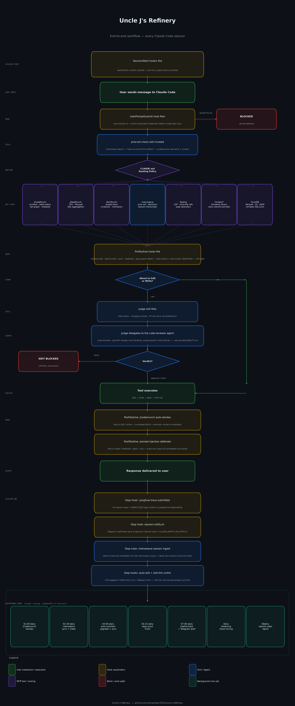

# Uncle J's Refinery

[](LICENSE)
[](https://github.com/williamblair333/Uncle-J-s-Refinery)
[](https://claude.ai/code)
[](docs/RELIABILITY.md)

**Uncle J's Refinery is a set of tools and rules that you install once on a Linux machine. After that, every Claude Code session on the machine gets cheaper, more accurate, and better informed than the one before.**

Claude Code forgets everything when you close the terminal. The Refinery keeps a searchable record of past sessions, so the next session starts from what earlier ones learned.

## Mission

The project has four goals. When two goals conflict, the one higher on the list wins.

1. **Right.** A correct answer matters more than any saving. Answers must rest on evidence you can check. A wrong or made-up answer is the most expensive thing the stack can produce, because someone may act on it.
2. **Cheap, in total.** Keep the cost of each correct answer low. Cost means tokens, money, *and your attention*. A part that saves tokens but needs hours of upkeep has not paid for itself.
3. **Inventive.** Look at other approaches before settling on one. Support creative work as well as code. Let the stack improve itself overnight.
4. **Local.** Run parts on your own machine when that costs nothing in accuracy or price. Local parts are cheaper, private, and keep working when an outside service fails.

Memory is a means, not a goal. Each session builds on the last because the stack remembers.

**The standing test:** every part must show, with a measurement, that it helps at least one of these goals. A part that can't is removed.

## What this looks like in practice

One install sets up ten MCP servers (an MCP server is a small program that gives Claude extra tools), an offline memory store shared by all your projects, and a set of hooks (scripts Claude Code runs before or after an action). It applies to every Claude Code project on the machine. Each piece serves one of the goals:

- **Right.** Four guard layers block destructive commands, leaked credentials, and prompt injection (text in a file or web page that tries to give Claude orders) before they take effect. A daily health check catches broken search indexes before they quietly make answers worse.
- **Cheap.** A symbol index lets Claude look up one function instead of reading a whole file. That cuts tokens by about 80% on real coding tasks. Output rules cut reply length by 25–40%. Telegram alerts and approval buttons mean you spend less time watching a terminal.
- **Inventive.** Each night a job replays the day's sessions, finds repeated mistakes and methods that worked, and adds them to Claude's instructions. Another hook drafts new skills from workflows you showed it.
- **Local.** The memory store, its embedding model, and the Langfuse session tracer all run on your machine. A question like "what did we decide about auth?" finds sessions from months ago, and the question never leaves the machine.

**Platform:** Linux (Debian/Ubuntu), built and tested on Debian with `apt`. Windows has a separate path; see [Prerequisites](#prerequisites).

---

## Contents

- [Mission](#mission)
- [What this looks like in practice](#what-this-looks-like-in-practice)
- [What you get](#what-you-get)
- [The namesake](#the-namesake)
- [What's in the box](#whats-in-the-box)
- [End-to-end workflow](#end-to-end-workflow)
- [Commercial use — read before you ship](#commercial-use--read-before-you-ship)
- [Prerequisites](#prerequisites)
- [Quick start](#quick-start)
- [Install guide](#install-guide)
  - [1. OS-level prerequisites](#1-os-level-prerequisites)
  - [2. Python stack and MCP server registration](#2-python-stack-and-mcp-server-registration)
  - [3. Verify](#3-verify)
  - [4. Confirm MCP servers](#4-confirm-mcp-servers)
  - [5. Global routing policy](#5-global-routing-policy)
  - [6. Reliability layer](#6-reliability-layer)
  - [7. Guardrails](#7-guardrails)
  - [8. Langfuse observability](#8-langfuse-observability)
  - [9. MCP performance tuning (optional)](#9-mcp-performance-tuning-optional)
  - [10. Stack update alerts (optional)](#10-stack-update-alerts-optional)
  - [11. GitHub webhook server (optional)](#11-github-webhook-server-optional)
  - [12. Bootstrap memweave (optional)](#12-bootstrap-memweave-optional)
  - [13. Telegram gateway (optional)](#13-telegram-gateway--approvals-and-alerts-optional)
  - [14. Telegram session notifications (optional)](#14-telegram-notify--session-end-messages-optional)
  - [15. Dreaming (optional)](#15-dreaming--nightly-lessons-from-your-sessions-optional)
  - [16. Session stats (optional)](#16-session-stats--weekly-efficiency-report-optional)
  - [17. Auto-skill (optional)](#17-auto-skill--automatic-skill-drafts-optional)
  - [18. Skill manager (optional)](#18-skill-manager--global-and-per-project-skills-optional)
  - [19. Ralph cron (optional)](#19-ralph-cron--scheduled-ralph-runs-optional)
  - [20. Product quality (optional)](#20-product-quality--briefs-first-run-gate-ui-audit-optional)
  - [21. Clean-room rebuild (REA)](#21-clean-room-rebuild-rea)
  - [22. Antigravity CLI (optional)](#22-antigravity-cli-agy--the-off-claude-agent-optional)
  - [23. Repo scout (optional)](#23-repo-scout--one-open-source-find-each-morning-optional)
  - [24. Prompt triggers (optional)](#24-prompt-triggers--naming-a-skill-invokes-it-optional)
- [Daily usage](#daily-usage)
- [Troubleshooting](#troubleshooting)
- [File map](#file-map)
- [What lives where after install](#what-lives-where-after-install)
- [Provenance](#provenance)
- [Uninstall](#uninstall)
- [License and credits](#license--credits)

---

## What you get

| Problem | What the Refinery does | Measured result |
|---|---|---|
| Claude reads a whole file to find one function | jCodeMunch parses your repo with Tree-sitter into an index of functions and classes. Claude asks the index instead of reading files. | About 80% fewer tokens on real code tasks; up to about 95% when looking up one symbol in a large file |
| Large data files get pasted into Claude's context | jDataMunch profiles and slices CSV/TSV files. DuckDB runs SQL over Parquet and joins across files. | About 25,000× less data on the LAPD 1-million-row benchmark |
| Claude forgets everything between sessions | memweave saves past sessions and decisions as Markdown files and searches them offline | "What did we decide about auth?" finds sessions from months ago |
| Replies are padded with preamble and summaries | jOutputMunch rules in Claude's instructions remove the padding | 25–40% fewer output tokens |
| Destructive commands run without a check | Four guard layers: secret scanner, prompt-injection warning, shell-command rules, code-reviewer subagent | `rm -rf`, piping a download into a shell, and direct pushes to main are blocked before they run |
| You can't see what Claude did | Langfuse, running locally in Docker, records every turn with its tool calls, timings, and token counts | Full session replay in a local web page |

---

## The namesake

The project is named for **J. Gravelle** ([@jgravelle](https://github.com/jgravelle)). He wrote the four tools that do the core work:

- **jCodeMunch** looks up code by symbol (about 95% fewer tokens per read on large files; about 80% across real mixed sessions).
- **jDataMunch** looks up rows and columns in tabular files (about 25,000× less data on the LAPD 1-million-row benchmark).
- **jDocMunch** looks up one section of a document instead of the whole file.
- **jOutputMunch** is a set of instruction rules that cut output tokens by 25–40%.

Everything else here (memweave, Serena, Context7, DuckDB, Superpowers, Ralph, the guardrails, Langfuse, the custom skills, the install scripts) is plumbing and rules built around those four tools. If this stack saves you tokens, the credit belongs to him first.

---

## What's in the box

| Layer | Component | What it does |
| --- | --- | --- |
| **Find code** | jCodeMunch | Tree-sitter index of every function and class; returns just the code you ask for |
| | Serena | Uses a language server (the engine behind "go to definition" in an editor) for Python, TypeScript, Rust, Go and C# |
| **Find data** | jDataMunch | Indexes CSV/TSV files; returns profiles, slices and totals |
| | DuckDB MCP | SQL over Parquet, JSON, CSV, and S3/GCS/R2 storage |
| **Find docs** | jDocMunch | Your project's docs, one section at a time |
| | Context7 | Other people's library docs, matched to the version you use |
| **Memory** | memweave | Offline memory shared by all projects: a Markdown corpus with local semantic search (search by meaning, not exact words). MCP tools `memory_search` and `memory_read` (`scripts/memweave/mw_mcp.py`), plus the `mw_search.py` command |
| **Local model** | ask_local | MCP server that hands small, low-stakes jobs (summarize, extract JSON, draft) to a model on your GPU. Ollama by default, or llama-server per host via `config/ask_local.env`. `just ask-local-up` starts it. Code: `scripts/ask_local/server.py`; details in `docs/STACK.md` |
| **Local chat page** | `just chat` | Web page at `http://127.0.0.1:8091`. Start, stop and read logs for the local llama-server; chat with it; or send a question to Claude (`claude -p`, your login, no tools or hooks) or agy for a second opinion. A "Search the web" box adds SearXNG results and the text of the top pages (`SEARXNG_URL`, default `127.0.0.1:8086`). "Speak replies" reads answers aloud. `/image`, `/video` and `/speak` show results in the page. Conversations are saved in `state/local_chat/`. Code: `scripts/local_chat/` |
| **Local speech** | `just whisper` / `just tts` | Speech to text (whisper.cpp large-v3-turbo, `127.0.0.1:8092`) and speech in a cloned voice (Chatterbox Nano, `127.0.0.1:8093`). Both run on the CPU in Docker. See `docs/STACK.md` |
| **Local images and video** | `just comfy` / `just image` / `just video` | ComfyUI on `127.0.0.1:8188`. Z-Image-Turbo makes images (about 32 s at 1024²). Wan 2.2 makes 5 s clips (about 8 min on a 12 GB GPU). Jobs wait for Klarheit's trials and stop Heretic while they run. See `docs/STACK.md` |
| **Small CPU model** | `just small` | Qwen3.5-2B/4B Heretic on a CPU llama-server (`127.0.0.1:8096`), for hosts without a GPU (Pi, tc-vmh-03). Code: `docker/llama-small/` |
| **Quiet browser** | `just browser` | A Claude session with Mozilla's Firefox DevTools MCP. The Firefox profile contacts only the sites you visit. Code: `scripts/firefox-mcp.sh` |
| **Live view** | live_preview | Watch a build step by step in a browser. A project publishes one image per step; a local page shows the newest image and the step history. MCP tools `preview_publish` and `preview_watch`, plus `just preview …`, from any project. Code: `scripts/live_preview/` (viewer copied from CLI-Anything, Apache-2.0) |
| **Delegation** | delegate | MCP server that hands work to models other than Claude: agy (Gemini), Heretic (local), an OpenAI-compatible API, and local image, video and speech. See [section 22](#22-antigravity-cli-agy--the-off-claude-agent-optional) |
| **Shorter output** | jOutputMunch | Instruction rules that cut output tokens by 25–40% |
| **Clean text** | jscrub | Finds and removes invisible Unicode characters (zero-width, direction marks, tag characters, look-alike spaces) that break diffs, grep and paste. A local command, not an MCP server. Code: `scripts/jscrub/` |
| **Reliability** | Superpowers | 20+ skills: brainstorming, test-driven development, step-by-step debugging, checking work before calling it done |
| | Ralph Wiggum | Runs an agent in a loop until checks pass |
| | prior-art-check | Custom skill. Searches memweave (`mw_search.py`) before non-trivial work |
| | judge | Custom skill. Asks a code-reviewer subagent to check an edit before it lands |
| | occams-razor | Custom skill. When diagnosing a failure, tries the explanation with the fewest assumptions first. Used for diagnosis only, not for cutting scope |
| **Rules enforcement** | jCodeMunch hooks | Run at PreToolUse, PostToolUse, PreCompact, TaskCompleted and SubagentStart |
| | dwarvesf guardrails | A secret scanner on every prompt, and a prompt-injection warning on tool output |
| | Shell-command rules | Block destructive `rm`, piping a download into a shell, direct pushes to main, sending data to webhook services, and permission-skipping flags |
| | credential-guard | Runs before **every** tool call, shell and MCP included. No tool may touch credential files (`~/.ssh`, cloud CLI logins, `.env*`, private keys, `/etc/shadow` and others), not even to read them. If the guard itself breaks, it lets calls through. Code: `hooks/discipline/credential-guard.sh` |
| **Observability** | Langfuse | Runs locally in Docker. Records every turn with tool calls, timings and token counts |
| **Optional features** | Stack alerts | Daily job checks whether each package is behind its GitHub repo. Claude judges whether the update matters and sends a Telegram message with buttons. Tap ✅ to upgrade |
| | Telegram gateway | Approvals and alerts by Telegram: skill promotion, health-check failures, Ralph stalls, dreaming results, notes after `git pull` |
| | Telegram notify | Sends a Telegram message when each Claude session ends |
| | Dreaming | Daily: mines Langfuse traces for repeated mistakes and working methods, then writes them to memweave and CLAUDE.md |
| | Session stats | Weekly Langfuse report. Flags sessions that used many tokens, and feeds dreaming |
| | Auto-skill | At session end, reads the transcript and may draft a SKILL.md to `state/skill-drafts/`. Asks you by Telegram before installing it |
| | Skill manager | Links `global-skills/` and each project's `skills/` into `~/.claude/skills/` at session start. Also links `global-skills/` into `~/.agents/skills/` (Codex, Copilot CLI) and `~/.gemini/skills/` (Antigravity CLI), so other agents see the same skills. Full list: [`docs/SKILLS.md`](docs/SKILLS.md). Whole third-party skill collections live in a **skill library** next to the repo (`../skill-library`). Nothing loads it, so it costs no tokens. Commands: `just skill-lib sync`, `just skill-lib list [filter]`, `just skill-lib add <skill>` (scans it with cisco-ai-skill-scanner, then copies it in with its `LICENSE` and an `UPSTREAM` note; run `just skills` afterwards) |
| | Agent library | `code-reviewer` in `global-agents/`, linked to `~/.claude/agents/`. It also covers silent failures and shell security. Five other ECC agents were dropped on 2026-10-23; see docs/RELIABILITY.md |
| | Ralph cron | Runs the checked Ralph loop on a schedule, one cron job per PRD |
| | memweave sync | A session-end hook plus a nightly job (`uncle-j-memweave-sync`, 02:30) keep the memory store current |

`install.sh --auto-register` registers ten MCP servers at **user scope**, so they work in every Claude Code project on the machine. `--skip-optional` leaves out two of them: DuckDB, and `ask_local` (which only helps if you run a local model through Ollama, or llama-server via `config/ask_local.env`).

---

## End-to-end workflow

Each message you send passes through the pipeline below: hooks, routing rules, MCP tools, the judge and specialist agents, and the session-end jobs. Click the image to see it full size.

<p align="center">
  
</p>

[`docs/RELIABILITY.md`](docs/RELIABILITY.md) has a text version of this flow and a table of which agent runs when.

---

## Commercial use — read before you ship

This repo's own code (install scripts, skills, harness) is **AGPL-3.0**. You may use, change and self-host it for free. If you run a changed version as a network service, you must publish your changes under the same license. Four other pieces have their own terms.

**1. Uncle J's tools (jCodeMunch, jDataMunch, jDocMunch, jOutputMunch)**

Free for personal use. Commercial use needs a license from J. Gravelle.

- [Free for personal use](https://github.com/jgravelle/jcodemunch-mcp#free-for-personal-use)
- [Commercial licenses](https://github.com/jgravelle/jcodemunch-mcp#commercial-licenses)

**2. Claude Code and the Ralph Wiggum plugin (Anthropic)**

Claude Code is not open source. Its `LICENSE.md` says: "© Anthropic PBC. All rights reserved. Use is subject to Anthropic's Commercial Terms of Service." The Ralph Wiggum plugin ships from the same repo under the same terms.

[Anthropic's Commercial Terms of Service](https://www.anthropic.com/legal/commercial-terms) govern commercial use. They do not grant the right to redistribute or modify by default.

**3. Langfuse (self-hosted)**

Everything outside the `/ee` folder is MIT: free for commercial use, with no usage limits. The `/ee` folder holds enterprise features (SCIM, audit logs, data retention rules) that need a commercial license. See the [Langfuse open-source FAQ](https://langfuse.com/docs/open-source).

**4. Copied skills.** The `global-skills/` folders that contain an `UPSTREAM` file come from [mattpocock/skills](https://github.com/mattpocock/skills). They stay **MIT**, not AGPL, and each keeps its `LICENSE`.

**Everything else** (memweave, Serena, DuckDB MCP, Context7, Superpowers, dwarvesf/claude-guardrails, and the Langfuse template) is MIT. The only condition is attribution.

---

## Prerequisites

- **Bash 4+**
- **Python 3.11+.** The installer gets it through `uv` if it's missing.
- **Node.js 18+**, for Context7
- **Git 2.30+**
- **`just`** (`apt install just`). It's the repo's command menu. Optional: each recipe is one line you can run by hand.
- **Docker and the Docker Compose plugin**, for the ask_local Ollama backend and Langfuse. Both are optional but recommended.
- **About 22 GB free disk.** Langfuse images take about 5 GB, and its Postgres, ClickHouse and MinIO data grow over time. The ask_local model (`qwen3.5:9b`) takes about 7 GB.
- **A GPU is optional for ask_local.** Without one it works, but slowly: a minute or more per call, and about 6 GB of RAM while the model is loaded.
- **An internet connection.** The first run downloads about 2 GB of Python, Node and Docker packages.

The installers check for each prerequisite. They install a missing one where that's safe (such as `uv`). Otherwise they tell you what to install with `apt` and stop.

> **Windows:** `install.sh` is for Linux. Do **not** use it on Windows.
> The stack does run on Windows 11 with Git Bash, but registration, hook wiring
> and the venv layout all differ, and `jcodemunch-mcp init` must not be used.
> Follow **[`docs/WINDOWS-PORT.md`](docs/WINDOWS-PORT.md)** instead. It needs
> Windows Developer Mode (for real symlinks). Context7, which needs Node.js, and
> all cron jobs are unavailable there.

---

## Quick start

On a fresh machine, this installs the core stack plus Langfuse:

```bash
git clone https://github.com/williamblair333/Uncle-J-s-Refinery.git
cd Uncle-J-s-Refinery

./prerequisites.sh          # git, node, claude via your distro's package manager
./install.sh --auto-register
./verify.sh                 # expect all PASS
cp CLAUDE.md.merged ~/.claude/CLAUDE.md
./install-reliability.sh
./install-guardrails.sh
./install-langfuse.sh
```

Then open Claude Code in any project. The routing rules and hooks are already active.

---

## Install guide

Run every command from the repo root.

### 1. OS-level prerequisites

Installs git, Node.js LTS and the Claude Code CLI with your package manager. It skips anything already installed.

```bash
./prerequisites.sh
```

It supports **Debian/Ubuntu** (`apt-get`). On other distros, install the prerequisites by hand.

### 2. Python stack and MCP server registration

```bash
./install.sh --auto-register
```

The script does these steps in order:

1. Installs `uv` (a fast Python package manager) if it's missing.
2. Creates `.venv/` with `uv venv --python 3.11`.
3. Runs `uv sync`, which installs jcodemunch-mcp, jdatamunch-mcp and jdocmunch-mcp from their GitHub repos. `uv.lock` pins each to an exact commit.
4. Downloads Serena and DuckDB MCP ahead of time with `uvx`, so the first launch is faster.
5. Runs `jcodemunch-mcp init --yes --hooks --audit`. This adds the enforcement hooks to `~/.claude/settings.json` and appends the routing rules to `~/.claude/CLAUDE.md`.
6. With `--auto-register`, runs `claude mcp add -s user ...` for each MCP server.
7. Sets `MCP_TIMEOUT=60000` in Claude Code's settings. The default of 30 s is too short for Serena and MotherDuck to start the first time.
8. Registers the cron jobs for scheduled upkeep.

### 3. Verify

```bash
./verify.sh
```

Every check should say **PASS**. If one fails, see [Troubleshooting](#troubleshooting). The usual cause is that `~/.local/bin` is not on your `$PATH`.

### 4. Confirm MCP servers

```bash
claude mcp list
```

Each Refinery server should show `✓ Connected`. The three Google services (Drive, Gmail, Calendar) show `! Needs authentication` until you sign in to them with `/mcp` inside Claude Code. That's expected.

### 5. Global routing policy

```bash
cp CLAUDE.md.merged ~/.claude/CLAUDE.md
```

This file is Claude's standing instructions. It tells Claude which tool to try first: the symbol index before reading a file, and memory before a web search. It also holds the jOutputMunch rules that remove preamble and filler from replies.

**Why it matters:** without these rules, Claude reads whole files, which costs many tokens. With them, Claude asks the index first and reads a file only when it must.

### 6. Reliability layer

```bash
./install-reliability.sh
```

This installs two custom skills:

- `~/.claude/skills/prior-art-check/SKILL.md` searches memweave (`mw_search.py`) at the start of each non-trivial task, to answer "have we solved this before?"
- `~/.claude/skills/judge/SKILL.md` asks a code-reviewer subagent, armed with index data, to check each Edit or Write before it lands.

It also installs two Anthropic marketplace plugins at user scope, so they work in every project:

- **Superpowers**: 20+ skills, including brainstorming with design checkpoints, test-driven development, step-by-step debugging, requesting a code review, and checking work before calling it done.
- **Ralph Wiggum**: `/ralph-loop`, which runs an agent in a loop until exit conditions you set are met.

If `claude` is not on your PATH when the script runs, install the plugins by hand inside a Claude Code session:

```
/plugin marketplace add anthropics/claude-code
/plugin install superpowers@claude-plugins-official --scope user
/plugin install ralph-loop@claude-code-plugins --scope user
/reload-plugins
```

### 7. Guardrails

```bash
./install-guardrails.sh
```

This installs `jq` if missing, then runs dwarvesf's `install.sh`. That script merges its settings into `~/.claude/settings.json` without removing the jCodeMunch hooks already there.

It adds two hooks:
- `UserPromptSubmit` → `scan-secrets.sh` blocks a pasted credential before Claude sees it.
- `PostToolUse` (Read, WebFetch, Bash, `mcp__.*`) → `prompt-injection-defender.sh` warns Claude when tool output contains text that looks like an injected order. It warns; it never blocks. The upstream version never fired, so `scripts/fix-guardrails-defender.sh` (run by `install-guardrails.sh`) installs a repaired copy from `hooks/guardrails/`.

It also adds five `PreToolUse` shell-command rules. They block:
- Destructive `rm` commands
- Piping a download into a shell (`curl ... | sh`)
- Direct pushes to main or master
- Sending data to webhook.site or ngrok
- Permission-skipping flags (`--dangerously-skip-permissions` outside approved places)

### 8. Langfuse observability

```bash
./install-langfuse.sh
```

Langfuse records what an AI app does. Here it records each Claude turn: tool calls, timings, token counts, and the full prompt and reply. You read the records in a local web page.

**If Docker isn't installed (Linux):**

```bash
curl -fsSL https://get.docker.com | sh
sudo usermod -aG docker "$USER"
# Log out and back in (or: newgrp docker) so group membership takes effect
```

The installer then:

1. Clones `doneyli/claude-code-langfuse-template` and sets it up for this machine. This includes a workaround for a ClickHouse crash on Linux 6.18 Liquorix; see [Troubleshooting](#langfuse-clickhouse-crashes-with-stdstof-no-conversion).
2. Writes `.env` with random passwords and keys.
3. Runs `docker compose up -d`, retrying up to 3 times. The first download is about 5 GB, and startup takes 90–120 s.
4. Installs the Langfuse Stop hook into `~/.claude/hooks/`.
5. Installs `langfuse>=3.0,<4` into the stack's venv. This avoids Debian 13's block on system-wide pip installs (PEP 668).
6. Adds the Stop hook and the `LANGFUSE_*` settings to `~/.claude/settings.json`.

**Langfuse page:** http://localhost:3050
Login: `admin@localhost.local`. The password is `LANGFUSE_INIT_USER_PASSWORD` in `claude-code-langfuse-template/.env`.

### 9. MCP performance tuning (optional)

`install.sh` already gives MCP servers 60 seconds to start (`MCP_TIMEOUT=60000`). The default 30 s is too short for Serena and MotherDuck on first launch.

To make later starts faster (from 14–24 s down to 7–18 s), install Serena, MotherDuck and Context7 as real programs. Then Claude Code doesn't fetch them through `uvx` or `npx` on every launch:

```bash
uv tool install --from git+https://github.com/oraios/serena serena-agent
uv tool install mcp-server-motherduck

# If npm's global prefix requires root (i.e. `npm prefix -g` returns /usr/local),
# configure a user-local prefix first:
[ "$(npm prefix -g)" = "/usr/local" ] && npm config set prefix ~/.npm-global
npm install -g @upstash/context7-mcp

claude mcp remove serena
claude mcp add -s user serena -- "$HOME/.local/bin/serena" start-mcp-server --context ide-assistant

claude mcp remove duckdb
claude mcp add -s user duckdb -- "$HOME/.local/bin/mcp-server-motherduck" --db-path :memory: --read-write --allow-switch-databases

claude mcp remove context7
claude mcp add -s user context7 -- "$(npm prefix -g)/bin/context7-mcp"

claude mcp list
```

### 10. Stack update alerts (optional)

A daily job checks whether each of the three core Python packages is behind its GitHub repo. If one is, Claude judges whether the update is worth taking and sends you a Telegram message with two buttons. Tap ✅ and Claude upgrades the package. Tap ❌ and the update is dropped without further messages.

```bash
bash features/stack-alerts/install.sh
```

You need a Telegram bot token and your chat ID; see `features/stack-alerts/README.md`.

**Git is the source of truth.** `uv` installs the three core packages straight from their GitHub repos, not from PyPI, and `uv.lock` pins each to an exact commit. The check compares that commit with the newest commit on GitHub. So an update can be available before any PyPI release exists.

Run the check by hand at any time:

```bash
bash scripts/check-stack-freshness.sh
```

| Group | Tools | When to act |
|---|---|---|
| **Git packages** | jcodemunch, jdatamunch, jdocmunch | Behind the newest commit → upgrade |
| **Langfuse** | langfuse, langfuse-worker | A new version exists → pull it |
| **Langfuse infrastructure** | ClickHouse, Redis, Postgres | A new major version exists → information only. Update only if Langfuse's release notes ask for it |

MinIO uses a Chainguard image that patches known security holes on its own. No action needed.

To upgrade the Python packages to the newest commit:

```bash
cd "$STACK_ROOT"
uv lock --upgrade-package jcodemunch-mcp --upgrade-package jdatamunch-mcp \
  --upgrade-package jdocmunch-mcp && uv sync --inexact
```

**Post-merge hook.** `install.sh` installs a `git post-merge` hook that runs after every `git pull`. When `global-skills/` or the reliability installer changed, it reruns `install-reliability.sh` for you: it removes dead skill links and adds new ones. For bigger changes (new cron jobs, changes to `install.sh` or `CLAUDE.md`), it lists what you need to do, by Telegram or in the terminal.

### 11. GitHub webhook server (optional)

Lets GitHub tell this machine about events as they happen, so nothing has to poll.

| Event | Action |
|---|---|
| `push` | Runs `verify.sh` and sends the result to Telegram |
| `pull_request` opened or updated | Fetches the diff, has Claude review it, and posts the review as a GitHub comment |

GitHub needs a public URL that reaches this machine, such as [ngrok](https://ngrok.com), [Tailscale Funnel](https://tailscale.com/kb/1223/funnel), or a VPS.

```bash
bash features/github-webhook/install.sh
```

The installer checks dependencies, asks for your public URL, makes a webhook secret, installs a systemd user service, and registers the webhook on GitHub.

Full guide: [`features/github-webhook/README.md`](features/github-webhook/README.md)

### 12. Bootstrap memweave (optional)

memweave is the offline memory store shared by all your projects. `install.sh` creates its own venv, `.venv-memweave` (Python 3.12). After a fresh install the store at `~/.uncle-j-memory` is empty. To fill it:

```bash
bash scripts/memweave/sync_memory.sh --all
```

This turns your past Claude Code sessions, from every project, into Markdown files and indexes them for offline search. From then on, "what did we decide about X" finds answers.

Search the store at any time. Searching never changes it:

```bash
.venv-memweave/bin/python scripts/memweave/mw_search.py "why did we switch to GraphQL" --k 5
# --json for machine-readable output
```

**It stays current on its own.** The nightly `uncle-j-memweave-sync` job (02:30) and a session-end hook keep the store up to date, so you don't need to rerun `sync_memory.sh`. The index can always be rebuilt from the Markdown files in `~/.uncle-j-memory`. If the index is lost, one `sync_memory.sh --all` run restores it, so no separate backup is needed.

### 13. Telegram gateway — approvals and alerts (optional)

A job checks your Telegram bot every 2 minutes. It's for **approvals and alerts**, not general chat. The bot doesn't remember earlier conversations.

**Commands you can send:**
- `/work <message>` sends the message to a project agent with full context (working directory set to PROJ_ROOT, CLAUDE.md loaded). This agent has no limits on what it may tell you.
- `promote <id> global` / `promote <id> project` installs a skill draft from `state/skill-drafts/`.
- `promote <id>` asks Claude to decide the scope first, then asks you to confirm.

**Messages it sends you on its own:**
- The daily health check failed (07:00, from `healthcheck-notify.sh`)
- A new skill draft is ready after a session (from the auto-skill hook)
- `auto-maintain.sh` found packages behind GitHub and proposes an upgrade
- A Ralph loop reached its maximum iterations without finishing
- A dreaming run finished
- Someone from an unknown `chat_id` tried to use the bot, or an injection attempt was blocked
- A summary after `git pull` (new features, install steps, skills that need action)

It needs stack alerts (section 10) first, because it uses the same bot token and chat ID.

```bash
bash features/telegram-gateway/install.sh
# uninstall: bash features/telegram-gateway/install.sh --uninstall
```

**Security:** rate limits, blocking of injection patterns, removal of dangerous Unicode, redaction of paths and secrets in replies, and instructions that stop the bot from revealing the OS, kernel, paths, git details, MCP stack or credentials. Code: `scripts/lib/tg_security.py`.

Log: `state/telegram-gateway.log`

### 14. Telegram notify — session-end messages (optional)

A Stop hook that sends you a Telegram message when a Claude Code session ends, with one line on what Claude did.

```bash
bash features/telegram-notify/install.sh
# uninstall: bash features/telegram-notify/install.sh --uninstall
```

It needs `TELEGRAM_BOT_TOKEN` and `TELEGRAM_CHAT_ID` in `.env` (section 10 sets them).

### 15. Dreaming — nightly lessons from your sessions (optional)

Reads the past day's Langfuse traces and, with the `dream-synthesizer` skill, finds repeated mistakes and methods that worked. It writes a dated report to `~/.claude/dreaming-output/`, adds the report to memweave, and appends the working methods to `~/.claude/CLAUDE.md`. Running it twice doesn't add duplicates.

```bash
bash features/dreaming/install.sh
# manual trigger any time:
bash features/dreaming/dream.sh
# or from inside Claude Code: /dream
```

It runs daily at 2 AM by default (`DREAMING_CRON_SCHEDULE` in `state/dreaming.env`). Settings: `features/dreaming/README.md`.

### 16. Session stats — weekly efficiency report (optional)

Reads the past 7 days of sessions from Langfuse and writes a Markdown table: date, project, traces, tool calls, tokens. It flags sessions over 40k tokens. Dreaming reads the report on its next run.

```bash
bash features/session-stats/install.sh
# manual trigger: bash features/session-stats/stats.sh
# or from inside Claude Code: /stats
```

It runs every Sunday at 8 AM by default. See `features/session-stats/README.md`.

### 17. Auto-skill — automatic skill drafts (optional)

A Stop hook that reads the session transcript and asks Claude whether the session showed a workflow worth reusing. If so, it writes a draft `SKILL.md` to `state/skill-drafts/<id>-skill-draft.md`. You get a Telegram message with a 300-character preview and the command to install it:

```
promote <id> global
```

Nothing is installed until you send that command. Read the preview, then promote it or ignore it.

The hook runs at most once per session every 30 minutes (`SKILL_SUGGEST_COOLDOWN`, in seconds), one run at a time. It never runs on a repeated stop or in a headless `claude -p` session. Its review call loads no MCP servers, tools or hooks. Turn it off with `SKILL_SUGGEST=off`.

```bash
bash features/auto-skill/install.sh
# uninstall: bash features/auto-skill/install.sh --uninstall
```

### 18. Skill manager — global and per-project skills (optional)

At install time, links every skill in `global-skills/` into `~/.claude/skills/`. It also installs session-start and session-end hooks that add and remove a project's own `skills/` folder. So a project's skills are available only while you work in that project.

```bash
bash features/skill-manager/install.sh
# uninstall: bash features/skill-manager/install.sh --uninstall
```

### 19. Ralph cron — scheduled Ralph runs (optional)

Installs a cron job that runs the checked Ralph loop against a PRD file. The installer asks you for the schedule.

```bash
bash features/ralph-cron/install.sh
bash features/ralph-cron/install.sh --list       # show installed ralph crons
bash features/ralph-cron/install.sh --uninstall MARKER
```

### 20. Product quality — briefs, first-run gate, UI audit (optional)

Prevents "works on my machine" failures. Each project writes down its core job, its users, its first-run steps and how success is measured, in a `PRODUCT.md`. The first-run gate then tests those claims on a clean machine: a throwaway container, using only the documented steps. An exit code of 0 is not enough to pass. A tool that catches an error, prints a friendly message and exits 0 fails the gate. That's the point.

```bash
bash features/product-quality/install.sh
# uninstall: bash features/product-quality/install.sh --uninstall
```

The gate installs its own prerequisites inside the container it creates:

```sh
apt-get update && apt-get install -y python3 python3-yaml
```

Then:

```bash
python3 features/product-quality/first_run_gate.py .            # prove it on a clean machine
python3 features/product-quality/first_run_gate.py --check .    # validate the brief, no container
python3 features/product-quality/first_run_gate.py --check features/product-quality/fixtures/good-project
bash features/product-quality/retrofit.sh --root /opt/proj      # rank existing projects, read-only
```

Skills installed: `product-brief` (write the brief), `first-run-gate` (read a gate result), `product-focus-review` (judge features against the core job), and `ux-heuristics` (copied in, MIT; see `global-skills/ux-heuristics/ATTRIBUTION.md`).

### 21. Clean-room rebuild (REA)

For writing original software that does what an existing app does, without copying it. The `clean-room-rebuild` global skill walks through the authorization check, the levels of investigation, cleaning the spec, and the release checklist. It also covers how the Investigator (and only the Investigator) uses [REA](https://github.com/morluto/rea).

A clean-room rebuild needs a wall between the agent that studies the existing app and the agent that writes the new code. The operating system has to enforce that wall: put the Investigator on another machine, or the Implementer in a sandbox. Claude profiles and MCP scopes only change what a session can find; they don't stop it. The stack adds some hygiene on top:

```bash
scripts/clean-room-investigator.sh --init   # mark the investigator workspace once
scripts/clean-room-investigator.sh          # start claude under ~/.claude-investigator
```

Sessions in a marked workspace never go into the memweave store. `healthcheck.sh` fails if REA is installed in, registered in, or added as a skill to the account it runs in. A host that uses REA everywhere on purpose can opt out by adding `clean-room-wall` to `state/disabled-features`.

### 22. Antigravity CLI (agy) — the off-Claude agent (optional)

Gemini CLI stopped serving personal Google accounts on 2026-06-18. Antigravity CLI (`agy`, part of a Google AI Pro subscription) replaces it. One command gives it the stack: read-only shell and MCP permission rules, the same 8 MCP servers Claude runs, the routing rules (`~/.gemini/GEMINI.md` includes `CLAUDE.md`), and every global skill.

```bash
bash features/antigravity/install.sh                       # after installing and signing in to agy
.venv/bin/python scripts/ask_agy.py --cwd <repo> "question"  # headless, honest exit codes
.venv/bin/python scripts/referee.py --task "what it must do" --diff main  # Gemini judges Claude's work
```

In agy you run a skill with `/name`. Skills don't start on their own in print mode. `features/antigravity/README.md` covers the install, the permission test table to rerun after agy updates, and why `ask_agy.py` exists: agy reports success even when a command was blocked.

**The delegate MCP server** (`scripts/delegate/server.py`, registered at user scope by `install.sh`) puts agy and the local models in every project's tool list. Its tools: `ask_agy`, `ask_heretic`, `ask_openai` (off until `OPENAI_API_KEY` and `DELEGATE_OPENAI_MODEL` are set in its environment), `make_image`, `make_video`, `speak`, and `delegate_status`. `CLAUDE.md` tells Claude to delegate bounded work by default.

- Calls that would leave the machine are refused inside any folder listed in `config/delegate-local-only.txt`.
- Every call is logged to `state/delegate.jsonl`. Shell runs of `scripts/ask_agy.py` are logged there too, marked `"via": "cli"`.
- `ask_agy(task=light|code|hard|review)` picks a model tier, and falls back to another when Google's quota runs out. `light` tries Heretic and the local Ollama model first, for prompts that name no file and need no edits.
- `just offload` reports how much work went to agy and the local models.
- The `self-work-budget` hook (installed by `install-reliability.sh`) stops a session once for every 20 of its own Read, Edit or Bash calls made without a delegation. This pushes every project to hand work off. Change the number with `SELF_WORK_BUDGET`.

### 23. Repo scout — one open-source find each morning (optional)

An overnight job keeps a map of open-source agent tools, compared with what Uncle J already covers. Each category is marked **covered**, **thin** or **blank**. Each night it scouts one category and sends you one find by Telegram, with ✅ Yes / 🤔 Maybe / ❌ No buttons. A yes gets a read-only, in-depth review the next night. A yes to that review writes a hand-off note so you can try the tool in a session. The job never clones or installs third-party code. Stars, license and dates come from `gh api`, never from the model.

```bash
just scout-seed                         # build scout/map.md once, then review it
bash features/repo-scout/install.sh     # nightly at 04:15 (SCOUT_TIME=HH:MM to change)
just scout --dry-run                    # one run by hand, printed instead of sent
just scout-status                       # map review state, queue, pending, answers
```

Scouting stays off until you set `reviewed: true` in `scout/map.md`. Repos you list in `scout/inbox.md` are scouted first. Answers are saved in `scout/answers.json`, and a find you said no to is never sent again. It needs `gh` logged in and the Telegram setup from section 10 or 13. Design: `docs/superpowers/specs/2026-10-17-repo-scout-design.md`.

### 24. Prompt triggers — naming a skill invokes it (optional)

Claude decides on its own when to use a skill, so typing a skill's name doesn't guarantee it loads. This prompt hook spots a skill name in your message (`just-do-it`, `pre-mortem`, or any name written as `/name`) and tells Claude to run that skill first. It ignores task and system notifications.

The same installer adds more hooks:

- `meta_trigger.py` catches complaints like "why did I have to…" and makes Claude run expert-bar and a real check.
- `skill_router.py` compares your wording with the trigger phrases of judgment skills (gttp, think-wider, prior-art-check, occams-razor, referee and others) and names up to 3 for the turn. Measure it with `just router-bench`. Turn it off with `SKILL_ROUTER_OFF=1`.
- `skill_gate.py` holds Claude's first other tool call, once, until the named skills have run. Turn it off with `SKILL_GATE_OFF=1`.
- `alternatives_gate.py` blocks `git clone`, `hf download`, `ollama pull`, `docker pull` and `curl … | sh` installers until the alternatives-scan skill has recorded a scan of that target in the last 14 days (`features/prompt-triggers/alternatives_scan.py check <target>`). Your Gitea host and localhost pass. Putting `ALT_SCAN_SKIP="<reason>"` before the command skips the gate and logs the reason to `~/.claude/state/alternatives-scan/gate.jsonl`. `ALT_GATE_OFF=1` turns it off.

```bash
bash features/prompt-triggers/install.sh              # registers it in ~/.claude/settings.json
bash features/prompt-triggers/install.sh --uninstall
```

---

## Daily usage

Use Claude Code as usual. The stack is global: the routing rules and hooks apply in every project and every session.

For upkeep, run `just` in this repo to list the commands. The common ones: `just health`, `just test`, `just doctor --fix`, `just reindex`, `just recall "…"`, `just referee "…" --diff main`, `just audit`, `just install-gate`, and `just waiting` (what's waiting on you in every `/opt/proj` project, plus repos with unpushed work or no remote). `just` is the entry point in every repo, and CLAUDE.md §0 tells agents to use it.

**How to tell it's working:**
- Claude calls `search_symbols` or `get_file_outline` instead of `Read` on a source file.
- Replies don't start with "Great question!" or end with "I hope this helps!"
- Traces show up in Langfuse within seconds of each turn.
- Destructive commands are blocked before they run.

### Per-project customization

Put a `CLAUDE.md` in a repo's root to add to or override the global rules for that project. Put a `.claude/settings.local.json` there for project-only MCP servers, hooks or permissions.

### Skipping permission prompts for a folder

```bash
mkdir -p .claude
cat > .claude/settings.local.json <<'EOF'
{
  "permissions": {
    "defaultMode": "acceptEdits",
    "allow": ["Bash(*)", "Edit(*)", "Write(*)"]
  }
}
EOF
```

Never do this globally, or in a folder that holds credentials.

### Using Ralph (autonomous loop)

```bash
./ralph-harness.sh --prd ./PRD.md --repo /path/to/repo
```

Ralph's usual failure is declaring victory on a broken change. This harness stops only when the index tools agree the work is done: `get_pr_risk_profile < 0.65`, `get_untested_symbols == 0`, and the PRD marked DONE. Start from the template in `prd-template.md`.

### Runtime health check

`verify.sh` checks that the programs exist. `healthcheck.sh` checks that the stack is actually connected and answering. Use it to catch failures that install-time checks miss, such as an MCP server registered at the wrong scope or a Langfuse container that died overnight.

```bash
./healthcheck.sh            # --quick (default, ~6s)
./healthcheck.sh --full     # + nested claude -p smoke + Langfuse trace API (~60s)
```

The script only reads; it never repairs anything. Each failure includes a `fix:` line with the command to run. The last line of output is meant for scripts: `HEALTHCHECK: ok` or `HEALTHCHECK: fail (<n>) -- <first failing check>`.

It runs automatically:
- **At session start.** A hook runs `healthcheck.sh --quick` when each Claude Code session opens, and shows the result as a system reminder. Outside this repo it does nothing.
- **On `/health`.** This slash command runs `healthcheck.sh --full` mid-session.

### Config drift check

The stack's settings format changes over time. `refinery-doctor.sh` finds settings that haven't caught up: renamed env keys, MCP servers at an old scope, a missing jcodemunch hook that restores context after compaction (`hook-sessionstart`), a `~/.claude/CLAUDE.md` out of sync with the repo, template values never filled in, and a missing Alt+V image-paste key. `healthcheck.sh` asks "is it running?"; the doctor asks "is it up to date?"

```bash
bash scripts/refinery-doctor.sh            # dry-run: report only
bash scripts/refinery-doctor.sh --fix      # apply auto-fixable migrations
bash scripts/refinery-doctor.sh --check embed-model  # single check
```

The last line of output is meant for scripts: `DOCTOR: ok` or `DOCTOR: N migration(s) available`. `--fix` writes each file safely: it keeps a `.env.bak`, writes `.env.tmp`, then renames it into place. Exit code 0 means nothing to do; 1 means changes are pending.

---

## Troubleshooting

### `HEALTHCHECK: fail` in the session banner

The banner's `fix:` line says what to run. Common causes:

| Banner says | Fix |
|---|---|
| `mcp-servers-down(jcodemunch)` etc | `./install.sh --auto-register` |
| `jcodemunch-wrong-scope` | `claude mcp remove jcodemunch -s local ; claude mcp remove jcodemunch -s project` |
| `mcp-timeout` | Rerun `./install.sh`; it rewrites `MCP_TIMEOUT=60000` |
| `docker-down` / `langfuse-unhealthy` | `docker compose -f claude-code-langfuse-template/docker-compose.yml up -d` |
| `langfuse-sdk-missing` | Rerun `./install-langfuse.sh` |
| `memweave-store-empty` | `bash scripts/memweave/sync_memory.sh --all` rebuilds the store from the Markdown files |
| `cron-missing(...)` | Rerun `./install.sh`; it registers the cron jobs in step 6d |
| `stack-not-at-head` | `uv lock --upgrade-package jcodemunch-mcp --upgrade-package jdatamunch-mcp --upgrade-package jdocmunch-mcp && uv sync --inexact` |
| `post-merge-hook-missing` | `ln -sfn "$STACK_ROOT/scripts/post-merge-hook.sh" "$STACK_ROOT/.git/hooks/post-merge"` |
| `secrets` | Look at the matches it found; add the files to `.gitignore` or remove the secrets |
| `hook-no-fire` / `trace-api` (full mode) | `tail -5 ~/.claude/state/langfuse_hook.log`, then check that `from langfuse import Langfuse` works in the stack venv |

### Pasting an image does nothing

First check the clipboard. `xclip -selection clipboard -t TARGETS -o` should list `image/png`, and `xclip -selection clipboard -t image/png -o | wc -c` should be well above 0.

- If both look right, your terminal is catching Ctrl+V (Tabby does this). Press **Alt+V** instead. `refinery-doctor.sh --fix` adds that key to `~/.claude/keybindings.json` without touching your other keys. Restart Claude Code afterwards.
- If the byte count is 0, the copy itself failed. For example, "Copy image" from Gmail in Chromium claims to offer `image/png` but delivers nothing.

### `verify.sh` reports FAIL after a fresh install

Run `echo $PATH`. It must include `~/.local/bin`, where `uv` and the MCP programs live. If it doesn't, add this to your shell's startup file:

```bash
export PATH="$HOME/.local/bin:$PATH"
```

### MCP servers show ✗ Failed to connect

Check that the timeout is set:

```bash
python3 -c "import json; d=json.loads(open(f\"{__import__('os').path.expanduser('~')}/.claude/settings.json\").read()); print(d.get('env',{}).get('MCP_TIMEOUT','<unset>'))"
# expect: 60000
```

If it prints `<unset>` or a number below 60000, rerun `install.sh --auto-register`. If it's set and servers still fail, follow section 9 to install them as real programs.

### jcodemunch registered as `uvx jcodemunch-mcp` instead of the venv path

`jcodemunch-mcp init` registers itself through `uvx` during step 2. `install.sh` then removes that and registers the venv path instead, so rerunning it fixes things. On an older install you may still see it. To fix:

```bash
claude mcp remove jcodemunch
claude mcp add -s user jcodemunch "$STACK_ROOT/.venv/bin/jcodemunch-mcp"
# or just re-run:
./install.sh --auto-register
```

### Langfuse ClickHouse crashes with `std::stof: no conversion`

Seen on Linux 6.18 Liquorix. Other kernels may do the same when the container's `/sys/fs/cgroup/cpu.max` is an empty file. `install-langfuse.sh` mounts a file containing `max 100000` over that path. If you see the crash on a host where the installer didn't apply this, add the mount to the ClickHouse service's volumes:

```yaml
- ./clickhouse/cpu.max.override:/sys/fs/cgroup/cpu.max:ro
```

`./clickhouse/cpu.max.override` should hold the single line `max 100000`.

### The Langfuse page is up but traces don't appear

```bash
tail -30 ~/.claude/state/langfuse_hook.log
```

Common causes:
- `'Langfuse' object has no attribute 'start_as_current_span'`: the langfuse library is v4 or newer. Downgrade with `python3 -m pip install "langfuse>=3.0,<4"`.
- `Langfuse API keys not set`: the settings block is missing. Rerun `./install-langfuse.sh`.
- The log is empty and the hook's folder is missing: run `mkdir -p ~/.claude/state`.

### Langfuse containers fail to start (`dependency failed to start`)

Usually the disk is nearly full:

```bash
df -h /
docker system df
```

If less than 10 GB is free, free some space, or move Docker's data to another disk (`data-root` in `/etc/docker/daemon.json`). Then:

```bash
cd claude-code-langfuse-template
docker compose down -v
docker compose up -d
```

`-v` deletes the half-built volumes so Docker recreates them cleanly.

### Claude Code keeps asking for permissions

- For one folder: see [Skipping permission prompts for a folder](#skipping-permission-prompts-for-a-folder).
- For one session: `claude --dangerously-skip-permissions`.
- Inside a running session: `/permissions` opens the permission editor.

### jOutputMunch rules aren't taking effect

```bash
grep -c jOutputMunch ~/.claude/CLAUDE.md
# expect 1 or more; if 0, re-run step 5
cp CLAUDE.md.merged ~/.claude/CLAUDE.md
```

### Reset everything

```bash
# Back up first
cp -r ~/.claude ~/.claude.bak.$(date +%Y%m%d-%H%M%S)

# Stop Langfuse
(cd claude-code-langfuse-template && docker compose down -v)

# Remove MCP registrations
for s in jcodemunch jdatamunch jdocmunch serena duckdb context7 ask_local memweave live_preview delegate; do
    claude mcp remove "$s" 2>/dev/null
done

# Remove venv
rm -rf .venv .venv-test
```

Then start again from step 2.

---

## File map

```
Uncle-J-s-Refinery/
├── README.md                           ← this file
├── CLAUDE.md                           ← base routing policy
├── CLAUDE.md.merged                    ← full policy: routing + security + jOutputMunch (cp to ~/.claude/)
├── AGENTS.md                           ← the same policy, for other agents
├── CHANGELOG.md                        ← version history
├── HANDOFF.md                          ← hand-off notes between sessions + work log
├── ROADMAP.md                          ← roadmap (In Progress / Planned / Completed)
├── CONTRIBUTING.md                     ← how to contribute, commit format, session-end rule
├── SECURITY.md                         ← how to report a vulnerability privately
├── .session-end.yml                    ← this project's session-end checklist settings
├── PORTING.md                          ← notes for moving to a new machine
├── PRD.md                              ← Ralph-driven maintenance PRD
├── prd-template.md                     ← starting template for Ralph tasks
├── pyproject.toml                      ← Python dependencies, managed by uv
├── uv.lock
├── patch-jcodemunch-hook-paths.py      ← one-time fix for hook paths after moving the repo
├── LICENSE                             ← AGPL-3.0; each dependency keeps its own license
├── .venv/                              ← Python venv created by install.sh (gitignored)
│
├── prerequisites.sh                    ← step 1: git/node/claude
├── install.sh                          ← step 2: Python stack + MCP registration
├── finish-install.sh                   ← retry after reloading your shell
├── verify.sh                           ← step 3: all-pass check
├── healthcheck.sh                      ← runtime health check (--quick / --full)
├── install-reliability.sh              ← step 6: custom skills + guardrails clone
├── install-guardrails.sh               ← step 7: dwarvesf guardrails via their install.sh
├── install-langfuse.sh                 ← step 8: Docker + Langfuse + Stop hook
├── ralph-harness.sh                    ← Ralph loop with exit checks
│
├── scripts/
│   ├── auto-maintain.sh                ← scheduled self-maintenance
│   ├── check-stack-freshness.sh        ← installed vs newest version for each MCP tool (incl. the jmunch-console clone)
│   ├── jmunch-console.sh               ← starts jMunch Console (browser page for the MCP tools → :8765)
│   │                                     ⚠ needs a clone on each machine: git clone https://github.com/jgravelle/jmunch-console.git review/jmunch-console
│   ├── github-webhook-server.py        ← HTTP server for GitHub push/PR events
│   ├── healthcheck-notify.sh           ← daily Telegram message when the health check fails
│   ├── jcodemunch-reindex.sh           ← re-indexes jcodemunch after large changes
│   ├── jscrub/                         ← invisible-Unicode cleaner: inspect / clean / audit text files (standard library only, no MCP server)
│   │                                     engine copied from watermarks-remover (MIT); `jscrub check-vendor` proves it unchanged
│   ├── memweave/                       ← offline shared memory: sync_memory.sh (build) + mw_search.py (search)
│   ├── post-merge-hook.sh              ← git post-merge hook; reports new features
│   ├── ralph-cron-run.sh               ← runs ralph-harness.sh for one PRD (cron target)
│   ├── review-check.sh                 ← runs the code review checklist
│   ├── session-end-check.sh            ← pre-commit hook (blocks) + Stop hook (Telegram warning)
│   ├── session-notify.sh               ← Telegram message at session end
│   ├── skill-link.sh                   ← links one skill into ~/.claude/skills/
│   ├── skill-suggest.sh                ← suggests skills from a session's tool use
│   ├── stack-alerts-poll.sh            ← reads Telegram replies to upgrade messages
│   ├── stack-alerts-send.sh            ← sends an upgrade message to Telegram
│   ├── telegram-gateway-poll.sh        ← reads your Telegram messages; passes them to claude -p
│   ├── vault-session-check.sh          ← Stop hook: checks the vault session was saved (daily note exists, has this session's entry, tree clean). Warns; never blocks
│   └── lib/
│       ├── __init__.py
│       └── tg_security.py              ← input cleaner, output scanner, path checker, rate limiter
│
├── lib/
│   ├── eval-verdict.sh                 ← reads and sorts auto-maintain Part B verdicts. Kept in its
│   │                                     own file so tests can drive all six branches. Loading it
│   │                                     fails loudly: the script has no `set -e`, so a silent failure
│   │                                     would make Part B print nothing, and nothing looks like success
│   ├── feature-helpers.sh              ← shared installer helpers (prompt, write_env_var, cron)
│   ├── notify.sh                       ← sends notifications (reads NOTIFY_CHANNEL)
│   └── notify-telegram.sh              ← Telegram backend (send message, read reply, send text)
│
├── features/
│   ├── auto-skill/
│   │   └── install.sh                  ← Stop hook: suggests skills from session tool use
│   ├── dreaming/
│   │   ├── install.sh                  ← daily Langfuse trace mining → memweave store + CLAUDE.md
│   │   ├── dream.sh                    ← manual trigger
│   │   ├── dream.md                    ← /dream slash command
│   │   ├── README.md                   ← full feature docs
│   │   └── skills/                     ← dream-synthesizer skill (installed to ~/.claude/skills/)
│   ├── github-webhook/
│   │   ├── install.sh                  ← systemd user service + GitHub webhook registration
│   │   └── README.md                   ← setup guide, public URL needs
│   ├── ralph-cron/
│   │   └── install.sh                  ← one cron job per PRD for scheduled Ralph runs
│   ├── session-stats/
│   │   ├── install.sh                  ← weekly Langfuse report + /stats command
│   │   ├── stats.sh                    ← manual trigger
│   │   ├── stats.md                    ← /stats slash command
│   │   └── README.md                   ← full feature docs
│   ├── skill-manager/
│   │   └── install.sh                  ← links global-skills/ + project skills/ at session start
│   ├── stack-alerts/
│   │   ├── install.sh                  ← setup: Telegram credentials + cron
│   │   └── README.md                   ← feature docs, prerequisites, uninstall
│   ├── telegram-gateway/
│   │   └── install.sh                  ← cron job: Telegram → claude -p → Telegram reply
│   └── telegram-notify/
│       └── install.sh                  ← Stop hook: Telegram message at session end
│
├── global-agents/                      ← specialist subagents, linked to ~/.claude/agents/
│   └── code-reviewer.md
│
├── global-skills/                      ← skills for every project, linked to ~/.claude/skills/
│   ├── deep-repo-analysis/
│   ├── judge/
│   ├── orchestrator/
│   ├── outcomes/
│   ├── per-task-review-cycle/
│   ├── polling-bot-age-filter-fix/
│   ├── polling-bot-backlog-diagnosis/
│   ├── post-upgrade-mcp-integration/
│   ├── prior-art-check/
│   ├── session-end-checklist/          ← checklist Claude walks at session end (required → consider → custom)
│   ├── stack-not-at-head-remediation/
│   ├── stale-lock-diagnosis/
│   ├── stale-pending-memory-guard/
│   ├── telegram-gateway-security-audit/
│   ├── telegram-inline-button-promote/
│   └── verify-handoff-claims/
│
├── skills/                             ← this project's own skills (linked only in this repo's sessions)
│
├── tests/
│   ├── __init__.py
│   ├── test_auto_maintain_verdict.py   ← 20 tests for lib/eval-verdict.sh: all six Part B branches,
│   │                                     the VERDICT format, and the wiring. Copying the lib back
│   │                                     inline or adding `set -e` fails CI
│   ├── test_session_end_check.py       ← 10 tests for scripts/session-end-check.sh
│   ├── test_surface_write_guard.py     ← tests for the surface-write guard; KNOWN_GAPS are strict expected failures, so closing a gap fails CI until the list is updated
│   ├── test_vault_session_check.py     ← 18 tests for scripts/vault-session-check.sh; it must always exit 0 and never put file content in a warning
│   └── test_tg_security.py             ← tests for scripts/lib/tg_security.py
│
├── state/                              ← runtime state (gitignored except .gitkeep)
│   ├── origin-main-last-seen.sha       ← ⚠ EVIDENCE, NOT CACHE. The baseline for spotting
│   │                                     a rewritten origin/main. Deleting it quietly turns
│   │                                     detection off: the next run accepts whatever the
│   │                                     remote says as the new baseline.
│   ├── origin-main-regressions.log     ← append-only; empty means healthy
│   ├── stack-alerts-pending.json
│   ├── telegram-gateway-offset.txt     ← last Telegram update_id seen (prevents duplicates)
│   ├── telegram-gateway.log
│   ├── telegram-gateway-ratelimit.json
│   ├── dreaming.env                    ← dreaming settings (gitignored)
│   ├── dreaming.log
│   ├── session-stats.env               ← session-stats settings (gitignored)
│   └── skill-drafts/                   ← auto-skill drafts
│
├── docs/
│   ├── STACK.md                        ← one page per tool
│   ├── RELIABILITY.md                  ← the reliability layer in depth
│   └── SESSION-END.md                  ← the session-end checklist standard (three layers)
│
└── mcp-clients/
    ├── claude-code-mcp.json.tmpl       ← templates filled in at install time
    ├── claude-desktop-config-fragment.json.tmpl
    ├── cursor-mcp.json.tmpl
    └── windsurf-mcp.json.tmpl
```

Cloned at install time (gitignored):

```
├── claude-guardrails/                  ← dwarvesf/claude-guardrails
└── claude-code-langfuse-template/      ← doneyli/claude-code-langfuse-template
```

---

## What lives where after install

```
~/.claude/
├── CLAUDE.md                           ← routing + security + jOutputMunch (from step 5)
├── settings.json                       ← hooks, env vars, permissions.deny
├── .claude.json                        ← MCP server registrations (managed by `claude mcp add`)
├── skills/
│   ├── prior-art-check/                ← from step 6 (or skill-manager)
│   ├── judge/                          ← from step 6 (or skill-manager)
│   ├── dream-synthesizer/              ← from features/dreaming
│   └── <others>/                       ← linked from global-skills/ by skill-manager
├── commands/
│   ├── dream.md                        ← /dream slash command
│   ├── stats.md                        ← /stats slash command
│   ├── health.md                       ← /health slash command
│   └── ...
├── hooks/
│   ├── discipline/                     ← blocking PreToolUse guards + Stop hook (step 6)
│   │   ├── edit-surface-guard.sh       ← blocks Edit/Write on listed sensitive files until a pre-mortem has run
│   │   ├── grep-guard.sh               ← sends source-code reads (grep/rg/cat/sed/head/tail) to jcodemunch; checks each part of a command, allows pipes, logs and writes
│   │   ├── push-guard.sh               ← blocks direct pushes to main/master/production. Splits the command with python3+shlex (not a regex), falls back to a regex, and never lets a push through on error. Replaces the upstream guardrails hook; see docs/RELIABILITY.md
│   │   └── unpushed-warn.sh            ← Stop hook: warns when the branch is ahead of the remote
│   ├── pre-mortem-guard/               ← pre-mortem enforcement, kept in the repo (linked to ~/.claude/hooks/pre-mortem-guard/)
│   │   ├── surface-write-guard.sh      ← blocks shell writes that would get around the Edit/Write guard; fails loudly without jq
│   │   ├── token-guard.sh              ← blocks every direct write of a clearance token (reading is allowed) and deleting guard scripts
│   │   └── write-clearance-token.sh    ← the only approved way to create a pre-mortem clearance token
│   ├── langfuse_hook.py                ← Stop hook (step 8)
│   ├── scan-secrets/                   ← guardrail (step 7)
│   ├── scan-commit/                    ← guardrail (step 7)
│   └── prompt-injection-defender/      ← guardrail (step 7)
├── dreaming-output/                    ← dated dream + stats reports (fed into the memweave store)
│   ├── dream-YYYY-MM-DD.md
│   └── stats-YYYY-MM-DD.md
├── state/
│   ├── langfuse_hook.log
│   ├── langfuse_state.json
│   └── pending_traces.jsonl
├── projects/                           ← Claude Code session transcripts
└── logs/
    └── permission-events.jsonl
```

---

## Provenance

| Tool | Origin |
| --- | --- |
| jCodeMunch / jDataMunch / jDocMunch / jOutputMunch | [@jgravelle](https://github.com/jgravelle) |
| memweave | this repo (`scripts/memweave/`): offline memory shared by all projects |
| Serena | [oraios/serena](https://github.com/oraios/serena) |
| DuckDB MCP | [motherduckdb/mcp-server-motherduck](https://github.com/motherduckdb/mcp-server-motherduck) |
| Context7 | [@upstash/context7-mcp](https://www.npmjs.com/package/@upstash/context7-mcp) |
| Superpowers | [obra/superpowers](https://github.com/obra/superpowers) |
| Ralph Wiggum | [Anthropic claude-code marketplace](https://github.com/anthropics/claude-code) |
| Claude Guardrails | [dwarvesf/claude-guardrails](https://github.com/dwarvesf/claude-guardrails) |
| Langfuse template | [doneyli/claude-code-langfuse-template](https://github.com/doneyli/claude-code-langfuse-template) |

---

## Uninstall

```bash
# Stop Langfuse and drop its data
(cd claude-code-langfuse-template && docker compose down -v)

# Remove MCP registrations
for s in jcodemunch jdatamunch jdocmunch serena duckdb context7 ask_local memweave live_preview delegate; do
    claude mcp remove "$s" 2>/dev/null
done

# Remove uv tool installs and npm globals
uv tool uninstall serena-agent mcp-server-motherduck
npm uninstall -g @upstash/context7-mcp

# Back up user config, then wipe stack-specific bits
cp -r ~/.claude ~/.claude.bak.$(date +%Y%m%d-%H%M%S)
rm -rf ~/.claude/hooks ~/.claude/skills/prior-art-check ~/.claude/skills/judge
rm -f ~/.claude/CLAUDE.md

# settings.json needs surgical editing — delete the LANGFUSE/TRACE_TO/PYTHONUTF8
# env keys, remove the Stop hook entry, clear the jCodeMunch and guardrails
# entries from `hooks` if you want a clean slate.

# Remove the stack folder
cd ..
rm -rf Uncle-J-s-Refinery
```

---

## License & credits

This repo's own code (install scripts, the merged CLAUDE.md, custom skills, the Ralph harness, templates) is **AGPL-3.0**; see `LICENSE`. Each upstream part keeps its own license. [Commercial use](#commercial-use--read-before-you-ship) lists them all.

### First credit: the namesake

**J. Gravelle ([@jgravelle](https://github.com/jgravelle))** wrote the four tools this project is named for: jCodeMunch, jDataMunch, jDocMunch and jOutputMunch. Every saving quoted in this README comes from his idea of "index once, query cheaply" and his compact MUNCH output format. "Uncle J" is him. If this stack saves you tokens, the credit belongs to him first.

### Also credit where due

- Oraios ([oraios/serena](https://github.com/oraios/serena)): Serena, code intelligence through a language server
- The MotherDuck team: the DuckDB MCP server, which runs SQL over almost any data
- Upstash: Context7, library docs matched to your version
- Obra: the Superpowers skills, now in Anthropic's official marketplace
- Anthropic: Claude Code, the Ralph Wiggum plugin, and the marketplace
- Dwarves Foundation ([dwarvesf/claude-guardrails](https://github.com/dwarvesf/claude-guardrails)): the guardrails pattern
- The Langfuse team and doneyli ([doneyli/claude-code-langfuse-template](https://github.com/doneyli/claude-code-langfuse-template)): local observability
- Geoffrey Huntley: the original Ralph Wiggum `while true` agent loop

The rest of this repo (install scripts, the checked Ralph harness, the prior-art-check and judge skills, this README) connects those parts. The hard work was done upstream.
